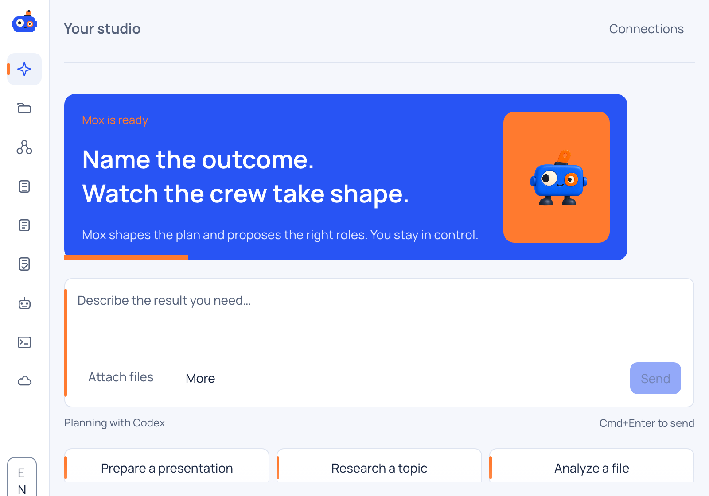
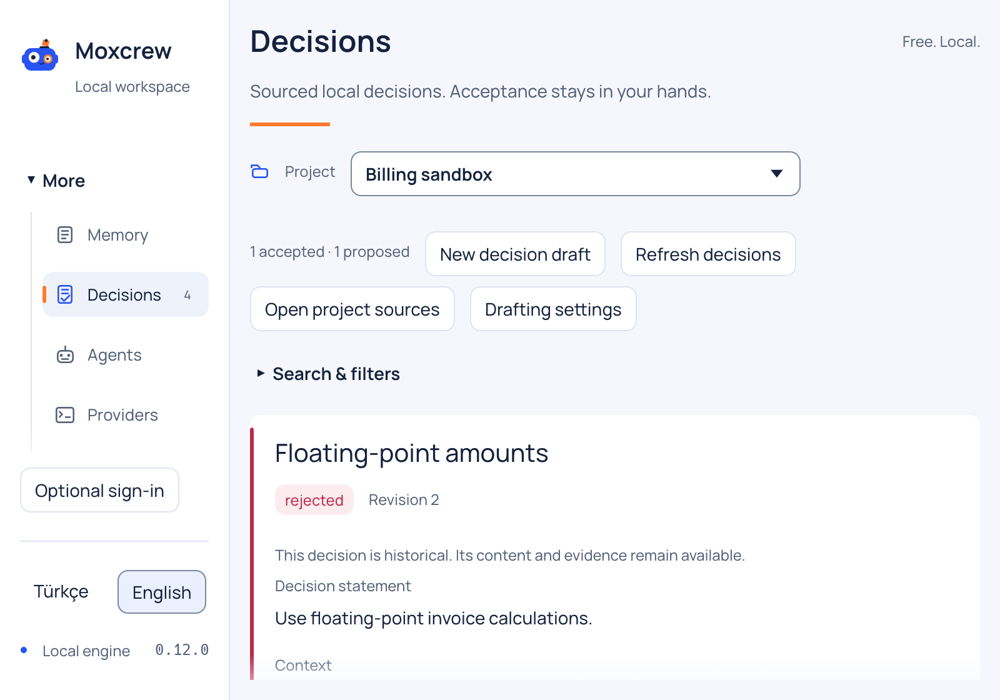
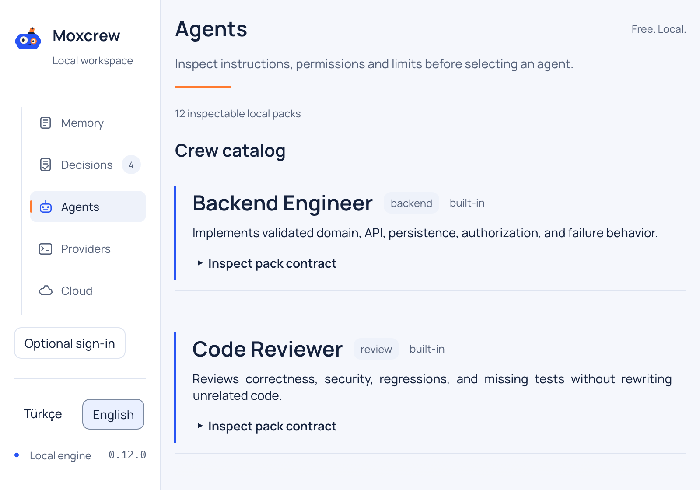

  <picture>
    <source media="(prefers-color-scheme: dark)" srcset="design/moxcrew/logos/moxcrew-reversed.svg">
    
  </picture>

<h1 align="center">One goal. A whole AI crew.</h1>

  Moxcrew is a native, local-first desktop app that turns a request into an
  inspectable plan, the right agent crew, durable project context and real
  outputs—using the AI tools you already have.

  
  
  
  
  

  <a href="https://github.com/BaydoganMirac/moxcrew/releases/tag/v0.12.0"><strong>Download Moxcrew</strong></a>
  · <a href="docs/roadmap.md">Roadmap</a>
  · <a href="https://github.com/BaydoganMirac/moxcrew/issues/new">Share feedback</a>

## Stop rebuilding context for every AI task

Codex, Claude Code and Gemini CLI are powerful, but useful work still gets
scattered across prompts, terminals, files and decisions. Moxcrew gives that work
a home.

- **Start with the outcome.** Write one request; Mox proposes the plan and roles.
- **Keep control.** Review the plan, access and crew before anything starts.
- **Keep the work together.** Projects retain context, tasks, outputs and accepted
  decisions.
- **Use your own AI access.** Connect an existing local Codex, Claude Code or
  Gemini CLI installation. Moxcrew does not resell model tokens.
- **Stay local by default.** Local use is free, needs no Moxcrew account and keeps
  source, prompts, paths, outputs and credentials off Cloud by default.

## From request to result

1. **Describe the result** and attach the files that matter.
2. **Review Mox's proposal**—plan, crew, tools and boundaries stay visible.
3. **Prepare, then start** when you are ready. Queueing never silently executes.
4. **Inspect and revise the output** without losing the original goal or source
   versions.
5. **Keep the decisions** that should guide the next task in the same Project.

Moxcrew is designed for research, writing, analysis, planning, personal work and
software development. Recipes, provider overrides and advanced Project tools are
available when needed; they are not prerequisites for the first request.

## A workbench, not another chat tab

<table>
  <tr>
    <td width="50%">
      
    </td>
    <td width="50%">
      
    </td>
  </tr>
  <tr>
    <td><strong>Decisions with evidence.</strong> Suggestions remain proposals until you accept them.</td>
    <td><strong>Agents with boundaries.</strong> Inspect roles, instructions and limits before use.</td>
  </tr>
</table>

The native workbench also includes Project memory, task queues, reusable crews,
provider diagnostics, output previews and an optional sanitized Cloud view.
Turkish and English interfaces, light and dark themes, and keyboard navigation
ship in the desktop application.

## Why local-first matters

Moxcrew's local host is the execution authority and canonical source of truth.
Cloud is optional and cannot run arbitrary shell commands on your machine. Any
remote action must be an allowlisted, versioned intent that the local host checks
and records with a receipt.

That means:

- provider credentials remain with their provider tools;
- local projects keep working without Moxcrew Cloud;
- uncertain work is shown instead of silently retried;
- accepted decisions and source versions remain auditable;
- explicit review gates stay between a proposal and execution.

Read the full [product boundaries](docs/product.md),
[architecture](docs/architecture.md) and [security policy](SECURITY.md).

## Download Moxcrew

Moxcrew 0.12.0 Public Preview ships as native installers—no Rust, Node or source
build is needed.

| Platform | Download |
|---|---|
| macOS Apple Silicon | [Download DMG](https://github.com/BaydoganMirac/moxcrew/releases/tag/v0.12.0) |
| macOS Intel | [Download DMG](https://github.com/BaydoganMirac/moxcrew/releases/tag/v0.12.0) |
| Linux x64 / ARM64 | [Download AppImage or Deb](https://github.com/BaydoganMirac/moxcrew/releases/tag/v0.12.0) |

This is an unsigned public preview. macOS may show a Gatekeeper warning; verify
the published SHA-256 checksums before opening an installer. Moxcrew never asks
you to bypass protection with a terminal command. The Windows package is withheld
until its native private-storage and installer gates pass.

For real planning or execution, install and authenticate at least one supported
provider CLI separately. See [installation and recovery](docs/install.md) for
platform steps, data locations, upgrades and rollback. Contributors can still
[build from source](docs/release.md#packaging).

## Current status

Moxcrew 0.12.0 is an active Public Preview for macOS and Linux. CI builds and
checks those native artifacts while retaining a visible experimental Windows
lane. Publisher-signed distribution, a passing Windows private-storage/runtime
gate, live quality evidence across every provider/capability and moderated
usability testing remain production-release gates.

The repository intentionally separates implemented behavior from future scope:

- [Public roadmap](docs/roadmap.md)
- [Release target and evidence](docs/state/version-one-release.md)
- [Documentation index](docs/README.md)
- [Contribution rules for coding agents](AGENTS.md)

## Help shape Moxcrew

If local-first, inspectable AI teamwork is useful to you:

- **Star the repository** to help more people discover the project.
- **Watch releases** to hear about preview updates and signed downloads.
- **Open an issue** with the outcome you want Moxcrew to handle or a problem you
  found in the development preview.

Moxcrew means **Mox + crew**: Mox shapes the work; the crew delivers it; you keep
authority over both.

## License

Moxcrew is available under the [Apache License 2.0](LICENSE).
Report vulnerabilities privately through the [security policy](SECURITY.md).
